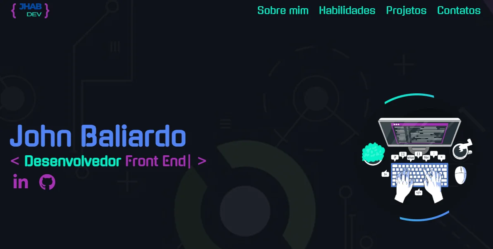
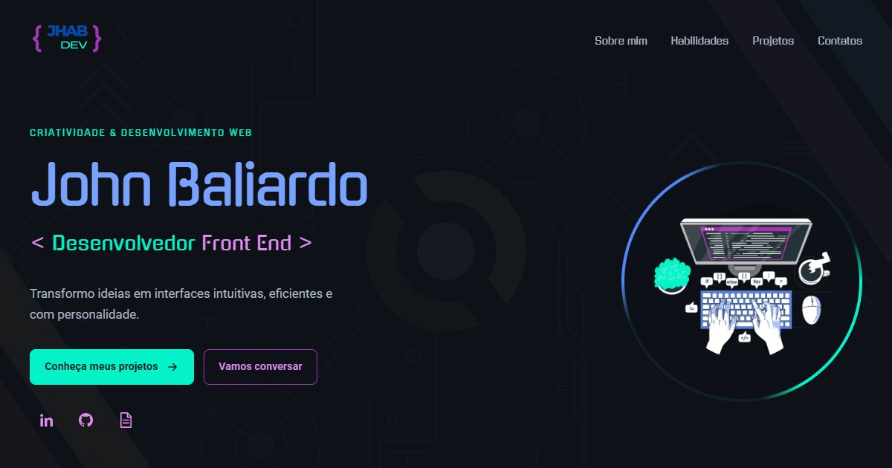

# John Baliardo · JHAB Dev

**Versão atual: 2.0.0**

Portfólio construído propositalmente com **HTML, CSS e JavaScript puros**, como registro da minha evolução e demonstração dos fundamentos do desenvolvimento Front End. A base continua a mesma, mesmo com minha atuação também em React.

O projeto preserva a identidade original: fundo tecnológico, paleta azul, verde e roxo, logo JHAB Dev, ilustrações e interações próprias.

[Acessar o portfólio publicado](https://srbaliardo.github.io/sitePortfolio/)

## Evolução do projeto

As duas versões usam HTML, CSS e JavaScript puros. As tags preservam o código e os arquivos de cada etapa, sem duplicar o site em pastas na versão atual.

| Versão | O que representa                                                                                              | Código                                                                           |
| ------ | ------------------------------------------------------------------------------------------------------------- | -------------------------------------------------------------------------------- |
| 1.0.0  | Portfólio original: identidade visual, interações e primeiras soluções com a base da web.                     | [Explorar a versão 1.0](https://github.com/SrBaliardo/sitePortfolio/tree/v1.0.0) |
| 2.0.0  | Evolução da apresentação profissional, acessibilidade, responsividade, desempenho e organização dos projetos. | [Explorar a versão 2.0](https://github.com/SrBaliardo/sitePortfolio/tree/v2.0.0) |

[Comparar as alterações entre 1.0 e 2.0](https://github.com/SrBaliardo/sitePortfolio/compare/v1.0.0...v2.0.0) · [Histórico das versões](CHANGELOG.md)

| Versão 1.0                                                            | Versão 2.0                                                    |
| --------------------------------------------------------------------- | ------------------------------------------------------------- |
|  |  |

## Executar localmente

Abra a pasta com o Live Server do VS Code ou inicie um servidor estático. Não há instalação de dependências, framework ou etapa de build para executar o site.

```powershell
python -m http.server 5500 --bind 127.0.0.1
```

Depois, acesse `http://127.0.0.1:5500`.

## Estrutura

- `index.html`: conteúdo, navegação, projetos disponíveis sem JavaScript e ícones SVG.
- `css/`: estilos, variáveis de identidade visual, tipografia local e adaptações de tela.
- `js/`: scripts separados por função, incluindo carrossel, menu, currículo, busca e integração com o GitHub.
- `js/projectsData.js`: seleção local para manter os projetos disponíveis sem conexão com o GitHub.
- `images/`: foto de perfil, identidade visual, imagem de compartilhamento e prévias WebP dos projetos. Somente os arquivos utilizados permanecem na versão atual.
- `docs/evolution/`: registro visual da versão original para comparação.
- `fonts/`: fontes Gugi e Roboto e suas licenças OFL.
- `resume.pdf`: currículo, com abertura direta, visualização em diálogo e download.

## Projetos e disponibilidade

Três projetos recebem destaque na página. Os demais podem ser explorados no carrossel, pela busca ou pelo filtro de linguagem principal. O botão de demonstração só é exibido quando existe um endereço cadastrado.

O catálogo consulta os repositórios públicos do GitHub com paginação e mantém um cache por 30 minutos. Se a conexão ou a API falhar, a seleção local continua disponível. Sem JavaScript, o HTML mantém os projetos, a apresentação completa, a navegação e o acesso ao currículo.

Para alterar os destaques, atualize os cards de `.featured-grid` no HTML e a lista `featured` em `js/projectsData.js`. A seleção local é uma fotografia dos projetos: para atualizar também a alternativa sem JavaScript, mantenha os cards do HTML e os dados locais em sincronia.

## Acessibilidade e movimento

Os controles utilizam elementos nativos, nomes acessíveis e foco visível. O menu pode ser fechado com Esc, assim como o currículo, que devolve o foco ao elemento de origem. A reprodução automática do carrossel é opcional, pausa durante a interação e respeita a preferência por movimento reduzido.

## Backup da revisão

A versão anterior está preservada na tag `v1.0.0`, com todos os seus arquivos. Os GIFs, imagens antigas e outros recursos substituídos podem ser consultados nessa versão, mesmo após sua remoção da pasta atual.

O ZIP original verificado também permanece em `.backups/`, com os arquivos e o histórico Git anteriores à revisão. Ele é uma cópia local de segurança e não é enviado ao GitHub. Para instruções de restauração, consulte `.backups/RESTAURAR.md`.

Para comparar o código localmente:

```powershell
git diff v1.0.0 v2.0.0 -- index.html css js
```

Para consultar a versão antiga, use a tag no GitHub ou faça um clone separado. Assim, os arquivos da versão atual continuam disponíveis na pasta de trabalho.

## About this project

This portfolio intentionally uses plain HTML, CSS and JavaScript to demonstrate and preserve my front-end foundations. It keeps its original visual identity while improving readability, accessibility, project discovery and loading performance. No framework or build step is required.
